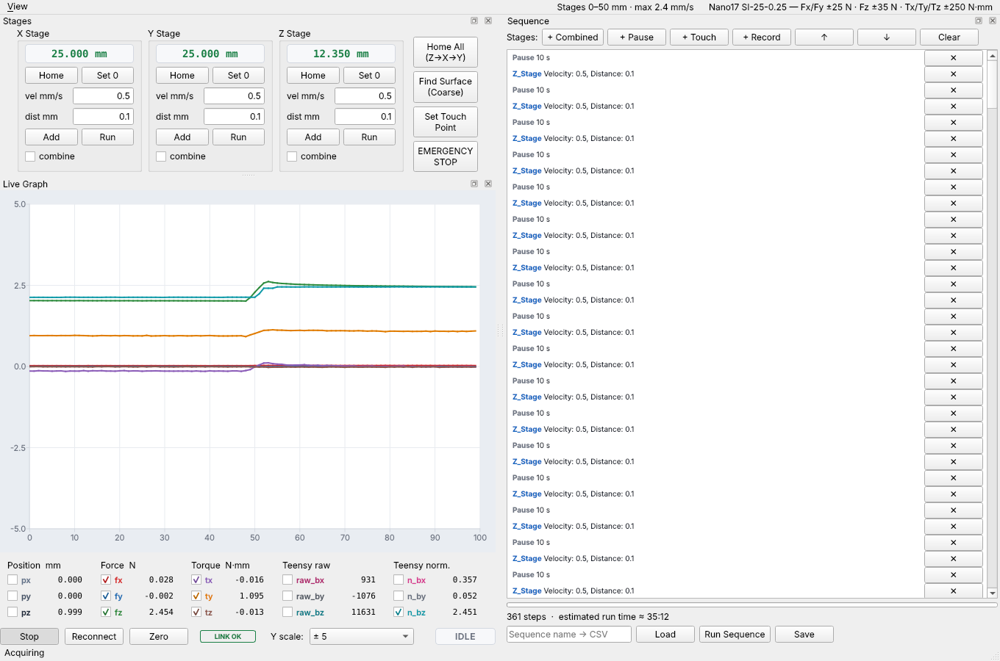
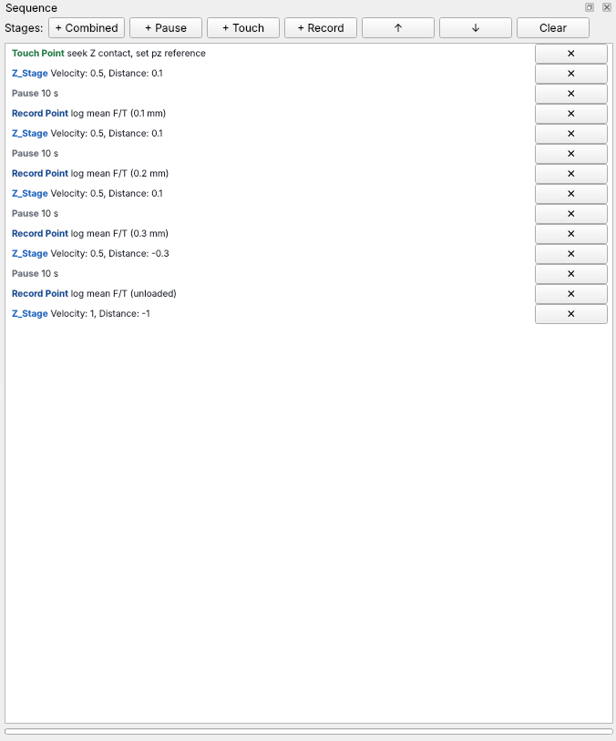

# Tactile sensor calibration rig (ATI Rig)

**ATI Rig** is the control and acquisition software of a three-axis test rig that
calibrates soft tactile force sensors against a reference six-axis force/torque
transducer (ATI Nano17). It drives three motorised linear stages, streams the reference
force/torque, stage position and the raw Hall-effect output of the sensor under test
at about 100 Hz, runs calibration protocols written as plain-text sequences, and
records everything to CSV for the calibration pipeline in
[sensor-tracking-studio](https://github.com/aarifcolakoglu-research/sensor-tracking-studio).

It was used to calibrate the sensors of the instrumented helmet in:

> Colakoglu A. A. *et al.* **Evaluation of an Instrumented Helmet for Measurement of
> Orthosis–Head Interface Forces in Pediatric Craniosynostosis.**
> *(manuscript under review; citation will be updated on publication)*

See [Versions and the version used in the article](#versions-and-the-version-used-in-the-article).



*The main window with the article's calibration sequence loaded (361 steps, about
35 min). The picture was made with the stages, the K64F board and the Teensy replaced
by the stubs of the test suite, while a recorded calibration file (sensor A3,
1 February 2026) was replayed through the live graph. The graph shows one 0.1 mm
indentation step (0.9 → 1.0 mm): the reference force F<sub>z</sub> rises from 2.0 to
2.45 N and the sensor's normalised B<sub>z</sub> follows it. The stage positions are
placeholders.*

---

## Contents

1. [What the software does](#what-the-software-does)
2. [Hardware](#hardware)
3. [Installation](#installation)
4. [The window](#the-window)
5. [Calibrating a sensor, step by step](#calibrating-a-sensor-step-by-step)
6. [Touch Point and Find Surface](#touch-point-and-find-surface)
7. [Sequences](#sequences)
8. [Output files](#output-files)
9. [Safety features](#safety-features)
10. [Configuration and data folders](#configuration-and-data-folders)
11. [Known hardware issues](#known-hardware-issues)
12. [Troubleshooting](#troubleshooting)
13. [Building and installing a Windows application](#building-and-installing-a-windows-application)
14. [Tests](#tests)
15. [Code layout](#code-layout)
16. [Versions and the version used in the article](#versions-and-the-version-used-in-the-article)
17. [Acknowledgements](#acknowledgements) · [Related repositories](#related-repositories) · [Citation](#citation) · [Licence](#licence)

---

## What the software does

- **Stage control.** It drives three Thorlabs KDC101 / MTS50-Z8 stages (X, Y, Z):
  - homing, either per axis or **Home All** in the order Z → X → Y;
  - jogging by a set distance and velocity;
  - setting a reference position;
  - remembering the homing direction of each axis.
- **Acquisition.**
  - Reference force and torque come from an ATI Nano17 through an NXP FRDM-K64F board
    (Ethernet). The board also reads the Z-stage encoder and timestamps each sample on
    board.
  - The raw B<sub>x</sub>, B<sub>y</sub>, B<sub>z</sub> of the sensor under test come
    from a Teensy (USB serial).
  - Each transducer record is paired with the most recent Teensy sample. Everything
    is shown live and written to a CSV at about 100 Hz.
- **Calibration protocols.** Sequences of moves, pauses, combined multi-axis moves,
  automatic contact detection (**Touch Point**) and point-wise force logging
  (**Record Point**). Sequences are edited in the window or loaded from text files;
  a run shows its progress and estimated time.
- **Contact detection.** **Set Touch Point** finds the sensor surface under force
  monitoring and sets the zero-indentation reference. **Find Surface (Coarse)** does
  the same over a wider range from a cold start.
- **Safety.** An emergency stop returns every moving axis to where its command
  started. In addition:
  - each sequence is checked against the travel limits before anything moves;
  - moves are limited in velocity and travel, and the stages are protected against
    stalls and overload;
  - the probe has force and force-rate guards.
- **Operation.** Dockable panes, light, dark and mixed themes, scalable fonts and
  selectable chart channels. It runs from source or as a packaged Windows application
  with logs.

## Hardware


*The rig (Figure S8 of the article): (a, b) design, (c, d) the assembled rig, (e, f) the
15 mm flat probe above a sensor. The ATI Nano17 carries the probe; the sensor sits in a
holder on the Thorlabs stages.*

| Part | Role | Connection |
|---|---|---|
| ATI Nano17 six-axis F/T transducer (SI-25-0.25; F<sub>x</sub>/F<sub>y</sub> ±25 N, F<sub>z</sub> ±35 N, T ±250 N·mm) | reference force and torque | strain-gauge signals to the K64F |
| NXP FRDM-K64F with a MikroE ADC 18 Click (firmware: [Needle_controller-mbed](https://github.com/WillEStokes/Needle_controller-mbed)) | samples the gauges and the Z encoder, applies the ATI 6 × 6 calibration matrix, timestamps each sample | Ethernet, static IP `192.168.5.101`, TCP port `7851` |
| 3 × Thorlabs KDC101 controllers with MTS50-Z8 stages | X, Y, Z motion; 0–50 mm travel, max. 2.4 mm/s | USB (Thorlabs Kinesis drivers) |
| Teensy microcontroller running [`firmware/single_sensor_calibration`](firmware/README.md) | streams the raw MLX90393 output of the sensor under test | USB serial, 115 200 baud, auto-detected (VID `0x16C0`) |
| 15 mm flat probe, sensor holder (3D-printed) | loading geometry | — |

The controller serial numbers (`STAGE_X_ID`, `STAGE_Y_ID`, `STAGE_Z_ID`) are at the top
of `app/ATI.py`; the K64F address (`IP_ADDRESS`, `TCP_PORT`) and the transducer
calibration matrix are in `lib/K64F.py`. Change them to match your own hardware.

## Installation

**Requirements**
- Windows 10 or 11, 64-bit.
- Python 3.11 or 3.12, 64-bit.
- [Thorlabs Kinesis](https://www.thorlabs.com) (64-bit). Restart the PC after installing it.

```powershell
git clone https://github.com/aarifcolakoglu-research/tactile-sensor-calibration-rig.git
cd tactile-sensor-calibration-rig
python -m venv .venv
.\.venv\Scripts\Activate.ps1
pip install -r requirements_acq.txt
python main.py
```

`requirements_acq.txt` pins the full environment the application is developed and run
in. It includes the Windows-only packages that `pylablib` uses to talk to the Thorlabs
controllers.

**Before the first run**
1. **Ethernet adapter for the K64F.** The board has a fixed address (`192.168.5.101`)
   and no DHCP. Give the PC's adapter a static IP in the same subnet: IP `192.168.5.2`,
   mask `255.255.255.0`, no gateway. Any free address in `192.168.5.0/24` works.
2. **Stages.** Connect and power the three KDC101 controllers. Check them once in the
   Kinesis interface, then **close Kinesis**; two programs cannot open the same
   controller.
3. **Teensy.** Flash `firmware/single_sensor_calibration` (Arduino IDE with
   Teensyduino, USB type *Serial*) and plug the Teensy in.

The application needs all three stages to start. Without them it stops during stage
initialisation with `Device Not Found`, which is expected on a PC without the rig.

## The window

The window has three dockable panes. Each can be moved, floated, closed and restored
through **View → Panes**.

**Stages pane**
- **One card per axis (X, Y, Z):**
  - the position in mm, in green when referenced and with a `?` or `⚠` when it is not
    or when the controller reports a fault;
  - **Home** drives to the limit switch and references there. Right-click it to home
    against the other switch, once or permanently;
  - **Set 0** sets the reference at the current position;
  - **vel mm/s** / **dist mm** with **Add** (append as a sequence step) and **Run**
    (move now);
  - **combine** marks the axis for a *Combined* step.
- **Toolbar:**
  - **Home All (Z→X→Y)**;
  - **Find Surface (Coarse)** and **Set Touch Point** (see [Touch Point and Find Surface](#touch-point-and-find-surface));
  - **EMERGENCY STOP**.

**Live Graph pane**
- **Chart:** the selected channels over the most recent samples. **Y scale** offers
  Auto or fixed ranges, with the Nano17's own limits marked.
- **Readout strip:** the latest value of every channel, in five groups:
  - position: `px`, `py`, `pz` (mm);
  - force: `fx`, `fy`, `fz` (N);
  - torque: `tx`, `ty`, `tz` (N·mm);
  - raw Teensy counts: `raw_bx`, `raw_by`, `raw_bz`;
  - normalised Teensy values: `n_bx`, `n_by`, `n_bz`.

  The checkbox by each name shows or hides that channel on the chart (force and
  torque are on by default; the choice is saved).
- **Buttons:**
  - **Acquire / Stop** starts and stops the data stream;
  - **Reconnect** re-opens the Ethernet link;
  - **Zero** takes the current, unloaded readings as offsets for the transducer and the
    sensor;
  - **LINK** turns green while samples arrive and red after 8 s without one; click it
    for the connection details;
  - **IDLE / RECORDING** shows whether a CSV is being written.

**Sequence pane**
- **Stages:** buttons add steps: **+ Combined**, **+ Pause**, **+ Touch**, **+ Record**.
  **↑ / ↓** reorder the selected steps, **×** or *Delete* removes them, **Clear** empties
  the list. Several rows can be selected.
- **Progress bar and line under the list:** the number of steps and the estimated run
  time. The estimate uses a measured per-move overhead and typical Touch Point timings.
- **Sequence name → CSV** names the output files. **Load / Save** read and write
  `sequences/*.txt`; **Run Sequence / Stop Sequence** runs or stops it.
- **While a sequence runs** the list is locked, the current step is highlighted and
  the remaining time counts down.

**View menu.** Theme (light, dark, mixed), font size (presets, *Custom…*, Ctrl + / Ctrl −),
panes, readout strip, status bar and *Reset window layout*. Preferences, window
layout and chart channels are kept in `config/ui.json`.



*The Sequence pane with `sequences/example_touch_record.txt` loaded: a Touch Point,
three 0.1 mm indentation steps each followed by a pause and a Record Point, and the
unloading.*

## Calibrating a sensor, step by step

1. Mount the sensor in the holder, connect its Teensy and start the application.
2. **Home All.** Z homes first, lifting the probe away from the sample, then X and Y.
   If Z fails, X and Y are not homed.
3. **Acquire.** Check that **LINK** is green and that the Teensy values in the readout
   change when the sensor is touched.
4. With the probe clear of the sensor, press **Zero**.
5. Bring the probe above the sensor: jog X / Y over it and Z to a few millimetres
   above it. From a cold start, **Find Surface (Coarse)** can do the Z part.
6. **Set Touch Point.** Z approaches until contact is detected and returns to the
   contact position, which becomes the zero-indentation reference
   (see [Touch Point and Find Surface](#touch-point-and-find-surface)).
7. **Load** the protocol, e.g. `sequences/C_Z1p8_H10_C5_R20.txt`.
8. Type the **sequence name**; it becomes the start of the output file names. Press
   **Run Sequence**. Before anything moves, every move is checked against the travel
   limits. Recording starts with the run and stops when it ends.
9. The files are written to `output/`. Rename the stream file to
   `<YYYY-MM-DD-HH-MM-SS>_<sequence>_<set>_<position>.csv` (for example
   `2026-01-31-21-53-30_C_Z1p8_H10_C5_R20_S1_MatC_C4.csv`) so that
   sensor-tracking-studio can identify the sensor (see [Output files](#output-files)).

## Touch Point and Find Surface

**Set Touch Point** (button, or a `Touch Point` sequence step) runs this routine:

1. **Baseline.** The routine takes the mean F<sub>z</sub> over 0.6 s.
2. **Approach.** Z moves towards the sensor at 0.15 mm/s for at most 9 mm.
3. **Contact.** Contact is accepted when the net force exceeds 0.015 N (about 1.5 gf)
   for 50 ms. The stage position at that moment is latched as `touch_pz`.
4. **Overtravel and retract.** Z presses 0.2 mm further, then retracts 0.8 mm at
   1.0 mm/s.
5. **Return.** Z returns to `touch_pz` in 0.02 mm steps at 0.15 mm/s, within 0.01 mm.

**Guards during the routine.** Z stops and retracts 1.0 mm if any of these happens:
- the net force exceeds 0.08 N;
- the force rises faster than 1.0 N/s;
- no new sample arrives for 1.5 s;
- the routine runs longer than 70 s.

In a sequence, a failed Touch Point is retried twice (Z retracts between tries). After
that the operator chooses **Retry**, **Skip this point** or **Abort sequence**, and Z
goes back to where the step started. Every attempt is a row in the calibration-point
file.

**Find Surface (Coarse)** locates the surface from a cold start. It uses the same
guards, but searches the travel actually left in front of the stage: 1.0 mm/s until a
5 mN pre-trigger, then 0.5 mm/s. Its timeout is sized to that range. Try it once
without a specimen before using it near delicate hardware.

All values are in `StagePanel._touch_config()` and `_coarse_find_config()`
(`app/ATI.py`) and `lib/set_touch_point.py`.

> The article's calibration recordings were made with v1.0, whose Touch Point used
> 0.5 mm/s and a 2.5 mm search range with the same force thresholds (see
> [Versions](#versions-and-the-version-used-in-the-article)).

## Sequences

A sequence is a plain-text file, one step per line. Lines starting with `#` are
comments; blank and unreadable lines are skipped, and the status bar reports how many
were skipped.

| Line | Step |
|---|---|
| `Pause Time: 10` | hold for 10 s |
| `Z_Stage Velocity: 0.5, Distance: 0.1` | move one axis by 0.1 mm at 0.5 mm/s; a negative distance moves back |
| `Combined X_Stage:0.5,0.1 Y_Stage:0.5,0.2` | move several axes together (`axis:velocity,distance`) |
| `Touch Point` | find the surface and set the zero-indentation reference |
| `Touch Point retract 3.5` | the same, then back off 3.5 mm |
| `Record Point <label>` | average F/T over 2 s and write one row labelled `<label>` (default `force`) to the calibration-point file |

Distances on the Y stage are sign-inverted before they are sent to the controller (rig
convention, `StagePanel._signed()` in `app/ATI.py`).

**Sequences included**

| File | Protocol |
|---|---|
| `C_Z1p8_H10_C5_R20.txt` | **the article's protocol:** Z to 1.8 mm in 0.1 mm steps at 0.5 mm/s, 10 s hold after every step, unloading in the same steps, 5 loading–unloading cycles, 20 s rest between cycles (361 steps, about 35 min) |
| `C_Z1p8_H10_C1_R20.txt` | the same protocol with one cycle, for a quick check |
| `C_X_Y_Z1p8_H10_C5_R20.txt` | three-axis version: the same stepping and hold pattern along X and Y as well as Z (3401 steps) |
| `example_touch_record.txt` | a short example of point-wise calibration with Touch Point and Record Point steps |

The file name encodes the protocol: `C` calibration, `X_Y_Z` axes, `1p8` 1.8 mm,
`H10` 10 s hold, `C5` 5 cycles, `R20` 20 s rest.

**Before a run** the whole sequence is simulated against each axis's travel limits from
the current positions. A move that would leave the safe range, or a step on an axis
that has no reference, blocks the run with a list of the problems. A sequence with
Touch Point or Record Point steps also needs live data (**Acquire**) before it starts.

## Output files

All files go to `output/`. File names start with the **sequence name** typed before
the run.

**Stream file**, `<name>_stream_<YYYY-MM-DD-HH-MM-SS>.csv`: the whole run at about
100 Hz, one row per transducer record.

| Column | Meaning |
|---|---|
| `real_time` | PC time, ISO 8601 with microseconds |
| `device_time_us` | K64F timestamp (µs, raw 32-bit counter) |
| `t_rel_us`, `dt_us`, `fs_hz` | time since the start of the recording, interval to the previous record, instantaneous rate; continuous across the 32-bit counter wrap (every 71.6 min) |
| `px`, `py`, `pz` | stage positions (mm) |
| `fx`, `fy`, `fz` | reference force (N), after **Zero** |
| `tx`, `ty`, `tz` | reference torque (N·mm), after **Zero** |
| `raw_bx`, `raw_by`, `raw_bz` | raw MLX90393 output of the sensor under test (signed 16-bit) |
| `status_byte` | MLX90393 status byte |
| `n_bx`, `n_by`, `n_bz` | the raw values minus the **Zero** offset, scaled to ±20 (display units) |

**Calibration-point file**, `<name>_calibration_<YYYY-MM-DD-HH-MM-SS>.csv`: written
only when the sequence contains Touch Point or Record Point steps. It has one row per
point. Line 1 is a `#` legend; read the file with `pandas.read_csv(path, comment="#")`.

| Column | Meaning |
|---|---|
| `iso_time`, `seq_step`, `label` | time, step number in the sequence, `touch` / `touch-skip` / the Record Point label |
| `n_samples`, `window_s` | samples averaged and window length |
| `fx_N`, `fy_N`, `fz_N`, `tx_Nmm`, `ty_Nmm`, `tz_Nmm` | mean force and torque over the window |
| `fz_sd_N` | standard deviation of F<sub>z</sub> in the window; low means a settled reading |
| `px_mm`, `py_mm`, `pz_mm` | mean stage position |
| `touch_pz_mm`, `touch_ok`, `touch_note` | latched contact position and result of a Touch Point |

**Compatibility.** The stream file has the same columns as the files recorded with
v1.0 for the article. Only the file name gained the `_stream_` tag, and `t_rel_us` /
`dt_us` now stay continuous across the 32-bit clock wrap; runs shorter than 71.6 min,
like the article's, are unaffected. The calibration-point file is an addition.

**For sensor-tracking-studio.** The calibration pipeline identifies each sensor from
the file name, `<YYYY-MM-DD-HH-MM-SS>_<sequence>_<set>_<position>.csv`, where `set` is
the sensor set (e.g. `S1_MatC`) and `position` the sensor (e.g. `C4`). Rename the
stream file accordingly.

## Safety features

| Feature | Behaviour |
|---|---|
| **EMERGENCY STOP** | Stops every stage at once. Each axis that the interrupted command was moving (a jog, Home / Home All, a sequence step, Set Touch Point, Find Surface) returns to where it was when that command began; an axis that was not moving is just stopped. |
| Homing order | Z → X → Y, so the probe is lifted before anything moves sideways; X and Y are not homed if Z fails. |
| Travel limits | Moves are checked against 0 mm and the far end minus a 0.5 mm margin. Without a reference, a single move is limited to 2 mm. |
| Velocity limit | 2.4 mm/s (MTS50-Z8 datasheet). Homing runs at 0.5 mm/s, and the axis backs 2 mm off the switch after a trip. |
| Stall and overload protection | If an axis makes less than 0.005 mm of progress in 3 s, or the controller reports current limit, overcurrent, motion, commutation or encoder faults, the motor is stopped within one poll (about 0.2 s). |
| Sequence pre-flight | The whole sequence is simulated against the travel limits before it starts. |
| Probe guards | During Touch Point and Find Surface the probe stops on force (0.08 N), force rate (1.0 N/s), stale data (1.5 s) or timeout. |
| Data watchdog | If no sample arrives for 8 s during acquisition, LINK turns red and the reconnect help is shown. |

## Configuration and data folders

Folders are resolved next to the packaged executable, or next to `main.py` when run
from source:

| Folder / file | Content |
|---|---|
| `sequences/` | sequence files (Load / Save) |
| `output/` | stream and calibration-point CSVs |
| `config/ui.json` | theme, font size, window layout, panes, chart channels |
| `config/stages.json` | homing direction per axis |
| `logs/ATI_Rig_<date>.log` | console output of the packaged application |

`config/`, `logs/` and `output/` are machine-specific and are not tracked by git.

## Known hardware issues

- **X stage '−' limit switch.** The X stage of this rig homes from its '+' end by
  default, because its '−' switch does not trigger. On a healthy rig set
  `DEFAULT_HOME_DIRECTIONS = {}` in `app/ATI.py`, or right-click X's **Home** and
  choose the '−' end permanently.
- **Controller cuts out during homing.** This is mechanical friction triggering the
  overcurrent protection, not a software fault. The lead screw needs cleaning and
  greasing.
- **K64F still booting.** A first connect can time out. The client builds a fresh
  socket for every attempt, so **Reconnect** works once the board is up.

## Troubleshooting

| Symptom | Cause / fix |
|---|---|
| No stages found / `Device Not Found` | Kinesis not installed, or the PC not restarted after installing it. Check that the Kinesis interface sees the controllers, then close it |
| `DeviceBackendError` / DLL not found | 32-bit Kinesis with 64-bit Python; both must be 64-bit |
| A stage connects once, then never again | The Kinesis interface is still open and holds the port |
| LINK red, cannot connect to the K64F | Static IP missing or on the wrong adapter (`ping 192.168.5.101`), then **Reconnect** |
| `unexpected command received: expected 0x…` | Unprompted status messages from a KDC101; already handled in `lib/stageController.py`. Do not add your own polling of the controller |
| No Teensy values | Wrong firmware or USB type; `python -m lib.find_ports` lists the serial devices |
| Touch Point fails with "Reached Z_MAX without touch" | The probe started too far from the surface; move closer or use **Find Surface (Coarse)** first |
| Touch Point fails with "Sensor stream stale" | Acquisition stopped or the link dropped; check LINK and press **Acquire** |
| `ModuleNotFoundError` | The packages were installed into another Python; activate `.venv` and install again |

## Building and installing a Windows application

```powershell
pip install pyinstaller
packaging\build.bat
powershell -ExecutionPolicy Bypass -File packaging\install.ps1
```

- **`build.bat`** is the only supported way to build. It uses `packaging\ATI_Rig.spec`,
  which excludes PyQt5 (pulled in by `pylablib`) and pins Qt's DLL search path.
- **`install.ps1`** copies the build to `%USERPROFILE%\ATI_Rig` and creates Start-menu
  and Desktop shortcuts. An upgrade keeps `config\`, `sequences\`, `output\` and
  `logs\`.
- Details are in [`packaging/README - Building the Windows app.md`](packaging/README%20-%20Building%20the%20Windows%20app.md).

Releases of this repository contain source code only. A packaged application includes
PyQt6 and is covered by the GPL v3 as well.

## Tests

The tests replace the stages, the K64F and the Teensy with stubs, so they run without
hardware (PyQt6 and `pylablib` must be installed):

```powershell
python -m unittest discover -s tests -t .
```

| File | Covers |
|---|---|
| `tests/test_app.py` | sequence grammar (every step type round-trips), loading and locking, pre-flight, time estimates, Touch / Record steps and the calibration-point file, emergency stop, clock-wrap handling, reconnect, the window and its layout |
| `tests/test_stage_controller.py` | return-to-point after an emergency stop, aborts during moves and homing, recovery of an interrupted home |
| `tests/test_two_stage_touch.py` | the touch-probe state machine against a simulated stage and specimen |

## Code layout

```text
main.py                   entry point: logging, data folders, theme, main window
app/ATI.py                stage cards, sequence editor and runner, touch routines,
                          emergency stop, main window and menu
app/Display.py            live graph, readout strip, acquisition and link handling
app/theme.py              palette, stylesheet, saved UI preferences
lib/stageController.py    KDC101 control: limits, homing, stall/overload protection,
                          return-to-point
lib/K64F.py               K64F Ethernet client, F/T transform, stream CSV writer
lib/TeensySerialv4.py     Teensy serial reader
lib/set_touch_point.py    touch-probe state machine (TouchConfig, TouchProbeRunner)
lib/find_ports.py         serial port discovery (Teensy VID 0x16C0)
lib/paths.py              data folders next to the .exe or the project root
lib/applog.py             console output mirrored to logs/ for the packaged app
sequences/                calibration sequences
firmware/                 Teensy sketch for the sensor under test (see firmware/README.md)
packaging/                PyInstaller spec, build and install scripts
tests/                    headless tests with stubbed hardware
docs/images/              pictures used in this README
```

## Versions and the version used in the article

| Tag | Date | Main changes |
|---|---|---|
| `v1.0` | Feb 2026 | Stage control, sequences, K64F/Teensy acquisition and the touch-probe routine. **Used to record the calibrations in the article** (sensor set S1_MatC, 31 Jan – 2 Feb 2026). |
| `v2.0` | Sep 2026 | Unified interface and themes, stage safety (stall/overload protection, homing fallback), link recovery, Windows packaging |
| `v3.1` | Oct 2026 | Touch Point and Record Point sequence steps and the calibration-point file; Find Surface (Coarse); EMERGENCY STOP with return-to-point; sequence pre-flight and time estimate; dockable panes and selectable chart channels; 32-bit clock-wrap handling; faster loading of long sequences; headless tests. Renamed *ATI Rig* (previously *ATI_App*). |

Each version is a tagged commit of this repository; check one out with, for example,
`git checkout v1.0`. The stream format is the same in all versions, so recordings made
with any of them are processed in the same way (see [Output files](#output-files)).

## Acknowledgements

This application is adapted from the needle-insertion test system by Will Stokes:
the stage control, K64F client and display structure come from
[NeedleInsertionApp](https://github.com/WillEStokes/NeedleInsertionApp), and the K64F
firmware and its Ethernet command protocol from
[Needle_controller-mbed](https://github.com/WillEStokes/Needle_controller-mbed).

## Related repositories

- [sensor-tracking-studio](https://github.com/aarifcolakoglu-research/sensor-tracking-studio): calibration pipeline (fits the equations from these recordings) and live monitoring of the 12-sensor array
- [helmet-contact-force-analysis](https://github.com/aarifcolakoglu-research/helmet-contact-force-analysis): analysis of the helmet force measurements (Figure 5, Figures S9–S12 and Table S4)

## Citation

Please cite the article above and this software (see `CITATION.cff`).

## Licence

[GNU General Public License v3.0](https://www.gnu.org/licenses/gpl-3.0.html) (GPL-3.0-only). See `LICENSE`.
