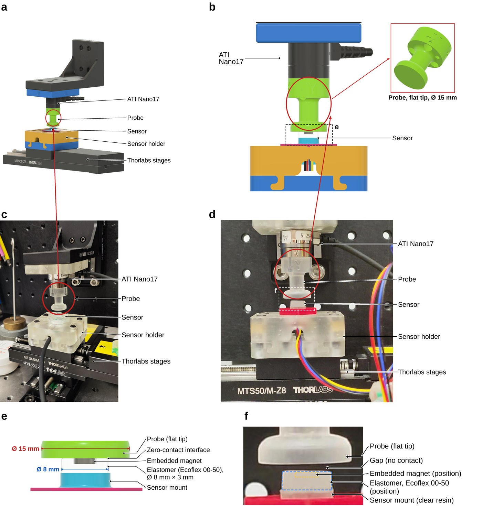

# Tactile sensor calibration rig (ATI_App) — version 2.0

> This is version 2.0 (September 2026). For the current version and its full
> documentation, see the latest release of this repository.

Control and acquisition software for a three-axis rig that calibrates soft tactile
force sensors against a reference force/torque transducer. The application is
called **ATI_App** (after the ATI transducer it reads); this repository contains its
source code, the Teensy firmware for the sensor under test and the calibration
sequence used in:

> Colakoglu A. A. *et al.* **Evaluation of an Instrumented Helmet for Measurement of
> Orthosis–Head Interface Forces in Pediatric Craniosynostosis.**
> *(manuscript under review; citation will be updated on publication)*

The rig indents a sensor in fixed steps with a motorised Z stage, holds at each step,
and records the reference force, the stage position and the sensor's raw Hall-effect
output in one CSV file. Those files are the input to the calibration pipeline in
[sensor-tracking-studio](https://github.com/aarifcolakoglu-research/sensor-tracking-studio),
which fits the force-conversion equations.


*The main window with the study's calibration sequence loaded (361 steps, about 35 min).
For this picture the stages and the transducer were replaced by a replay of a recorded
calibration file (sensor A3, 1 February 2026): the chart shows one 0.1 mm indentation
step, from 0.9 to 1.0 mm, with the reference force F<sub>z</sub> rising from 2.0 to 2.45 N
and the sensor's normalised B<sub>z</sub> following it. The stage positions are placeholders.*

---

## Contents

1. [Hardware](#hardware)
2. [The window](#the-window)
3. [Calibrating a sensor, step by step](#calibrating-a-sensor-step-by-step)
4. [Calibration protocol used in the study](#calibration-protocol-used-in-the-study)
5. [Sequence files](#sequence-files)
6. [Output](#output)
7. [Install and run (Windows)](#install-and-run-windows)
8. [Common problems](#common-problems)
9. [Code layout](#code-layout)
10. [Version used for the study](#version-used-for-the-study)

---

## Hardware



*The rig (Figure S8 of the article): (a, b) design, (c, d) the assembled rig, (e, f) the
flat probe above a sensor. An ATI Nano17 transducer carries a 15 mm flat probe; the
sensor sits in a holder on the Thorlabs stages.*

| Part | Role | Connection |
|---|---|---|
| ATI Nano17 six-axis F/T transducer (ATI Industrial Automation) | reference force | via the K64F board |
| FRDM-K64F board (NXP) | reads transducer gauges and stage encoder, converts to force with the ATI 6 × 6 calibration matrix, timestamps on board | Ethernet, `192.168.5.101:7851` |
| 3 × Thorlabs KDC101 controllers with MTS50-Z8 stages | X/Y/Z motion, 0–50 mm travel | USB (Thorlabs Kinesis) |
| Teensy microcontroller | streams the raw Hall output of the sensor under test (`firmware/single_sensor_calibration`) | USB serial, 115 200 baud |

The stage serial numbers and the K64F address are set at the top of `app/ATI.py` and
`lib/K64F.py`; change them to match your own hardware. The firmware and its serial
format are described in [`firmware/README.md`](firmware/README.md).

## The window

The window has two parts: stage control at the top and the live sensor panel below.
The split between them can be dragged.

**Stage cards (X, Y, Z).** Each card shows the stage position in mm and has:
- **Home**: drives to the limit switch and references there. Right-click to home
  against the other switch.
- **Set 0**: declares the current position as a reference.
- **vel / dist**, **Add** and **Run**: a velocity and distance that can be run at once or
  added to the sequence as a step.

**Sequence editor.** This is the list of steps the rig will run.
- **+ Combined** adds a move of several axes at once, chosen with the
  *combine X / Y / Z* boxes. **+ Pause** adds a hold.
- **↑ / ↓** reorder the steps, **×** deletes one and **Clear** empties the list.
- The line under the list shows the number of steps and the estimated run time, which
  includes the controller's per-move overhead.

**Run bar.**
- **Home All** homes the stages in the order Z → X → Y, so that the probe is lifted
  before anything moves sideways. If Z fails, X and Y are not homed.
- **Sequence name → CSV** names the output file.
- **Load / Save** read and write sequence files in `sequences/`.
- **Run Sequence** runs the list and records it.
- **Set Touch Point** and **Abort** start and stop the automatic contact search.

**Live sensor panel.**
- The chart shows F<sub>x</sub>, F<sub>y</sub>, F<sub>z</sub> (N), T<sub>x</sub>,
  T<sub>y</sub>, T<sub>z</sub> (N·mm) and the sensor's normalised B<sub>x</sub>,
  B<sub>y</sub>, B<sub>z</sub> over the most recent samples.
- **Y scale** sets the range: Auto, or fixed ranges with the Nano17's own limits marked.
- The readout strip gives the latest values: stage position, force, torque, raw Teensy
  counts and normalised Teensy values.
- **Acquire / Stop** starts and stops the data stream.
- **Reconnect** re-opens the Ethernet link.
- **Zero** tares the transducer and the sensor (offsets taken at the current, unloaded
  state).
- **LINK OK** shows the K64F link; it turns red if no sample arrives for 8 s.
- **IDLE / RECORDING** shows whether a CSV file is being written.

**View menu.** Theme, font size (Ctrl + / Ctrl −), readout strip, status bar and
*Reset window layout*. These preferences are kept in `config/ui.json`.

## Calibrating a sensor, step by step

1. Mount the sensor in the holder and connect its Teensy.
2. Start the application, then **Home All**.
3. Press **Acquire**, check that **LINK OK** is green and that the readout shows Teensy
   values.
4. With the probe clear of the sensor, press **Zero**.
5. Jog Z until the probe is just above the sensor, then press **Set Touch Point**.
   - Z approaches at 0.5 mm/s until the reference force exceeds 0.015 N (about 1.5 gf)
     for 50 ms.
   - It stops at once if the force exceeds 0.08 N or rises faster than 1 N/s.
   - After contact it presses 0.2 mm further and retracts 0.8 mm. It then returns slowly
     (0.15 mm/s in 0.02 mm steps) to the contact position, which becomes the
     zero-indentation reference.
6. **Load** the sequence (`sequences/C_Z1p8_H10_C5_R20.txt` for the study protocol).
7. Type the sequence name, following the naming scheme below, and press **Run Sequence**.
   The run is recorded from start to end; **IDLE** changes to **RECORDING**.
8. When the run ends, the CSV is in `output/`. Rename or copy it to
   `<YYYY-MM-DD-HH-MM-SS>_<sequence>_<set>_<position>.csv` for sensor-tracking-studio
   (see [Output](#output)).

## Calibration protocol used in the study

`sequences/C_Z1p8_H10_C5_R20.txt`:

- an automated touch-probe routine sets the zero-indentation reference (`lib/set_touch_point.py`)
- the Z stage advances in 0.1 mm steps at 0.5 mm/s to 1.8 mm, with a 10 s hold after every step
- it unloads in the same 0.1 mm steps and holds
- 5 loading–unloading cycles, with 20 s rest between cycles

The file name encodes the protocol: `C_Z1p8` Z axis to 1.8 mm, `H10` 10 s hold,
`C5` 5 cycles, `R20` 20 s rest.

## Sequence files

Plain text, one step per line:

| Line | Step |
|---|---|
| `Pause Time: 10` | hold for 10 s |
| `Z_Stage Velocity: 0.5, Distance: 0.1` | move one axis by 0.1 mm at 0.5 mm/s (negative distance = reverse) |
| `Combined X_Stage:0.5,0.1 Y_Stage:0.5,0.2` | move several axes together |

Lines that cannot be read are skipped, and the status bar reports how many were skipped.
Sequences can also be built in the editor and saved with **Save**.

## Output

Each run writes `output/<sequence name>_<YYYY-MM-DD-HH-MM-SS>.csv`, at about 100 Hz:

| Column | Meaning |
|---|---|
| `real_time` | PC time (ISO 8601, µs) |
| `device_time_us`, `t_rel_us`, `dt_us`, `fs_hz` | K64F timestamp, time since start, sample interval and rate |
| `px`, `py`, `pz` | stage positions (mm) |
| `fx`, `fy`, `fz`, `tx`, `ty`, `tz` | reference force (N) and torque (N·mm), after **Zero** |
| `raw_bx`, `raw_by`, `raw_bz`, `status_byte` | raw MLX90393 output of the sensor under test |
| `n_bx`, `n_by`, `n_bz` | the same after the **Zero** offset, scaled to ±20 for display |

The most recent Teensy sample is paired with each transducer record.
sensor-tracking-studio identifies each sensor from the file name, so calibration files
follow `<YYYY-MM-DD-HH-MM-SS>_<sequence>_<set>_<position>.csv`
(e.g. `2026-01-31-21-53-30_C_Z1p8_H10_C5_R20_S1_MatC_C4.csv`).

## Install and run (Windows)

You need Python 3.11 or 3.12 (64-bit) and [Thorlabs Kinesis](https://www.thorlabs.com)
(64-bit). Restart the PC after installing Kinesis.

```powershell
python -m venv .venv
.\.venv\Scripts\Activate.ps1
pip install -r requirements_acq.txt
python main.py
```

Before the first run:
- Set a static IP on the Ethernet adapter connected to the K64F (e.g. `192.168.5.2`,
  mask `255.255.255.0`).
- Close the Kinesis interface before starting the app; two programs cannot open the
  same controller.

The application needs all three stages to start. Without hardware it stops during stage
initialisation with `Device Not Found`.

To build a portable Windows program, use `packaging\build.bat` only; see
`packaging/README - Building the Windows app.md`.

## Common problems

| Symptom | Cause / fix |
|---|---|
| No stages found | Kinesis not installed, or the PC not restarted after installing it. Check that Kinesis' own interface sees the controllers |
| `DeviceBackendError` / DLL not found | 32-bit Kinesis with 64-bit Python; both must be 64-bit |
| A stage connects once, then never again | The Kinesis interface is still open and holds the port |
| Cannot connect to the K64F (LINK red) | Static IP missing or on the wrong adapter; check with `ping 192.168.5.101`, then **Reconnect** |
| Homing starts and the controller cuts out | Mechanical friction triggers overcurrent protection; the lead screw needs greasing |
| No Teensy values | Wrong USB port or firmware; `lib/find_ports.py` lists the serial devices |

## Code layout

```text
main.py                 entry point: logging, data folders, theme, main window
app/ATI.py              stage control panel (homing, jogging, sequences), main window
app/Display.py          live sensor display and chart
app/theme.py            palette, stylesheet, saved UI preferences
lib/stageController.py  KDC101 stage control with stall/overload protection
lib/K64F.py             Ethernet client for the K64F (F/T + encoder streaming, CSV logging)
lib/TeensySerialv4.py   Teensy serial reader
lib/find_ports.py       serial port discovery (Teensy VID 0x16C0)
lib/set_touch_point.py  touch-probe routine
lib/paths.py            data folders relative to the .exe or the project root
lib/applog.py           console output mirrored to logs/ for the packaged app
sequences/              calibration sequence
firmware/               Teensy sketch that streams the sensor under test (see firmware/README.md)
packaging/              PyInstaller build
docs/images/            pictures used in this README
```

## Version used for the study

The calibration recordings of the article (sensor set S1_MatC, 31 January – 2 February
2026) were made with an earlier version of this application (v1.0, February 2026).
This repository is v2.0, which adds stage safety checks, homing fallback, link recovery
and Windows packaging. The recorded CSV format and the calibration sequence are unchanged.

## Acknowledgements

This application is adapted from the needle-insertion test system by Will Stokes:
the stage control, K64F client and display structure come from
[NeedleInsertionApp](https://github.com/WillEStokes/NeedleInsertionApp), and the K64F
firmware and its Ethernet command protocol from
[Needle_controller-mbed](https://github.com/WillEStokes/Needle_controller-mbed).

## Related repositories

- [sensor-tracking-studio](https://github.com/aarifcolakoglu-research/sensor-tracking-studio): calibration pipeline and live monitoring
- [helmet-contact-force-analysis](https://github.com/aarifcolakoglu-research/helmet-contact-force-analysis): analysis of the helmet force measurements (Figure 5, Figures S9–S12 and Table S4)

## Citation

Please cite the article above and this software (see `CITATION.cff`).

## Licence

[GNU General Public License v3.0](https://www.gnu.org/licenses/gpl-3.0.html) (GPL-3.0-only). See `LICENSE`.
